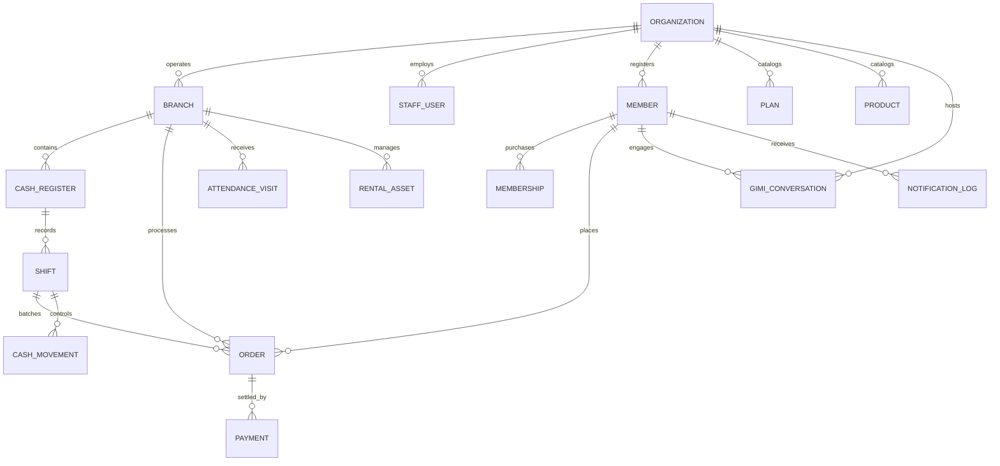
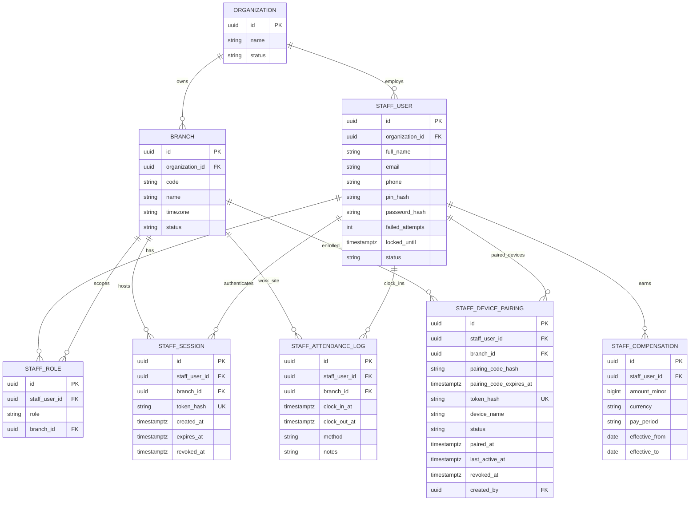
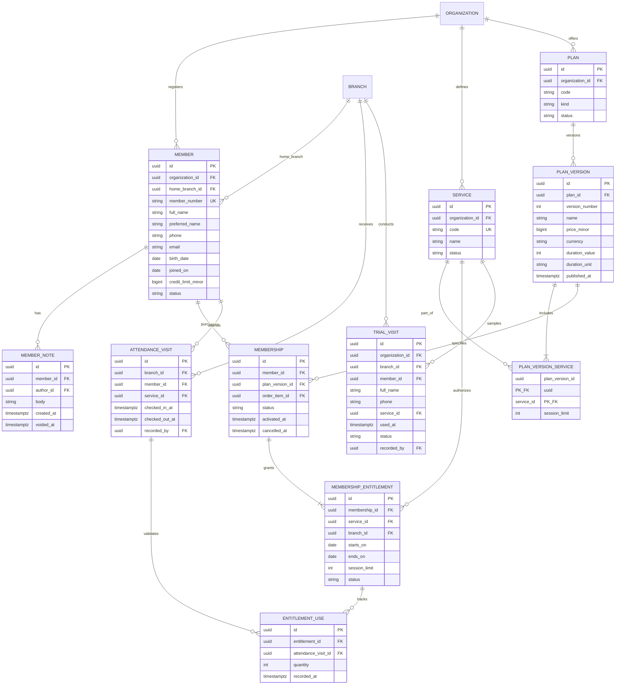
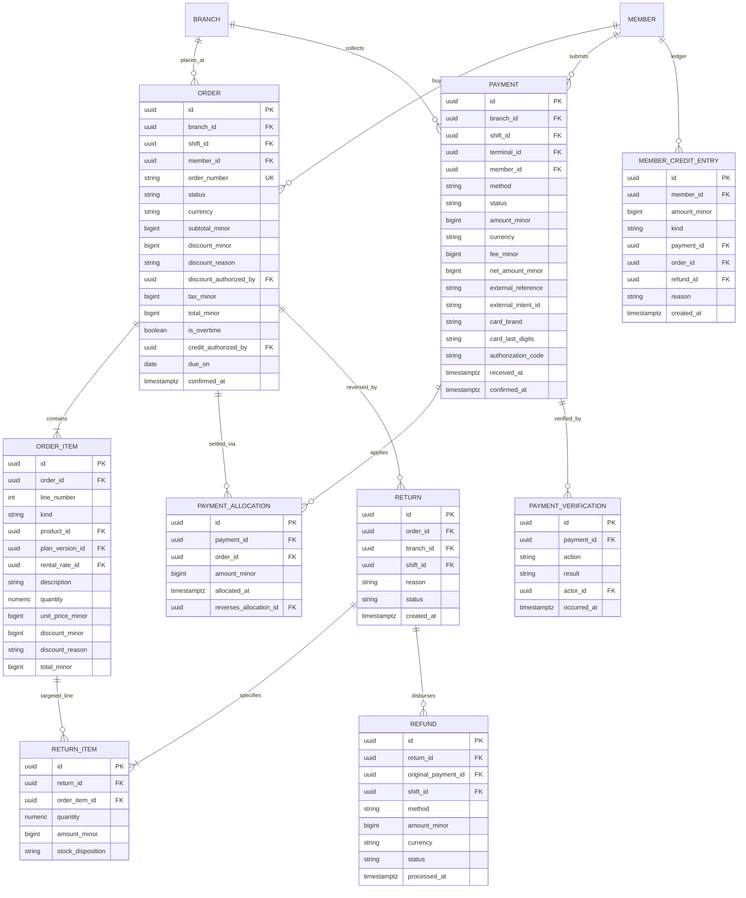
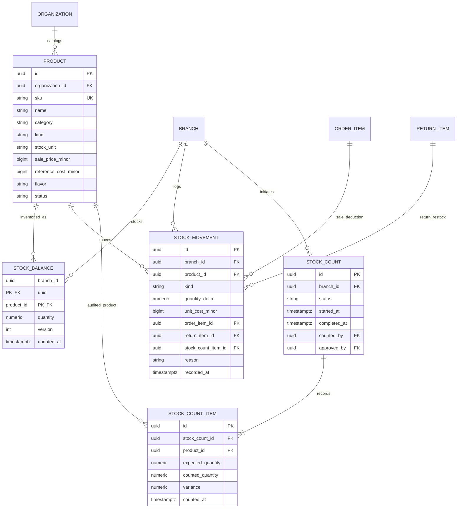
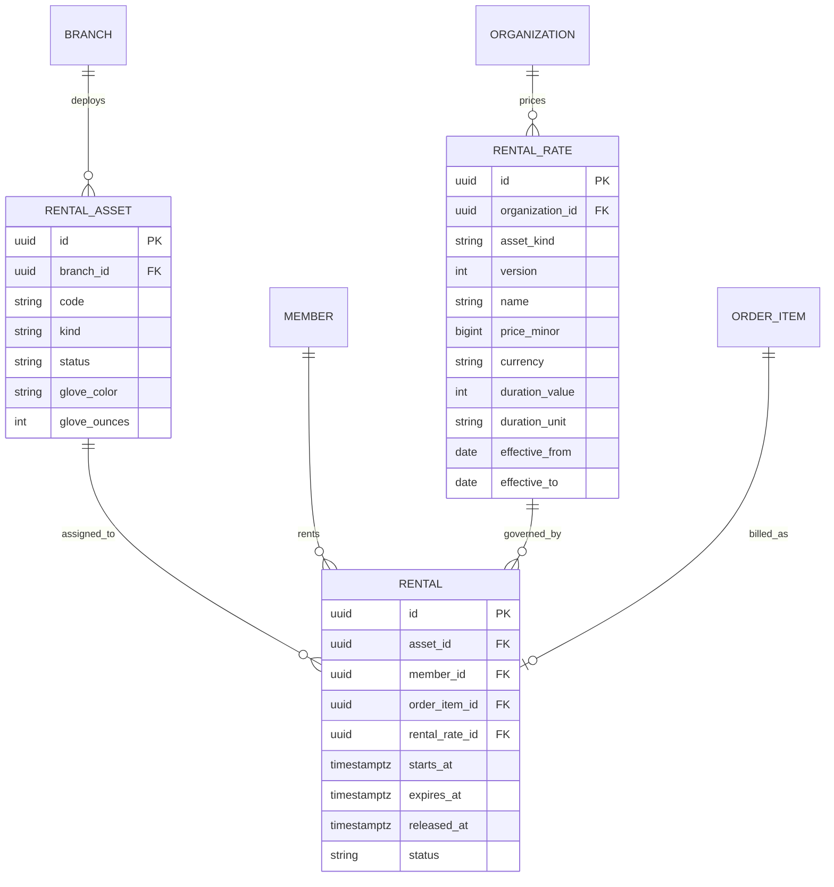
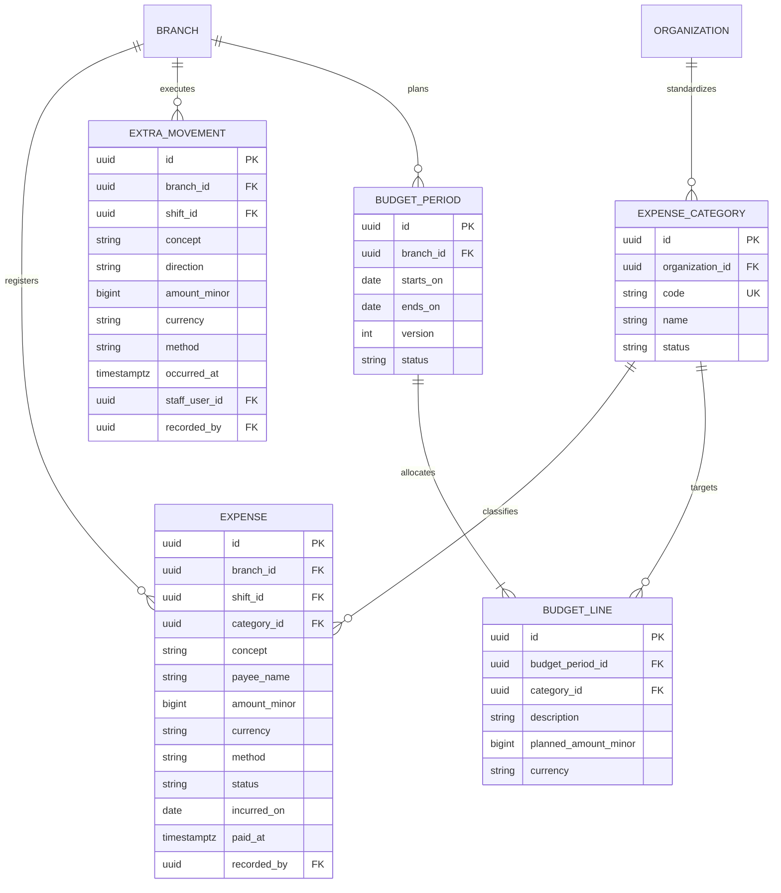
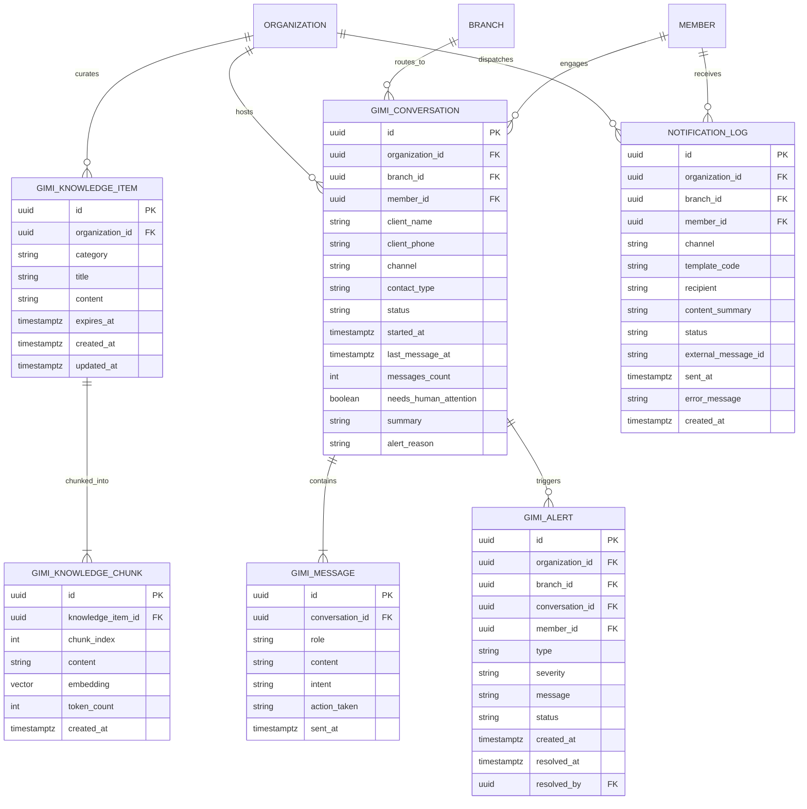
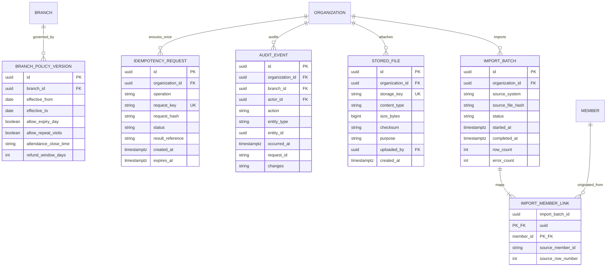

# EvoGym — Logical Entity-Relationship (ER) Architecture

Status: Proposed Logical ER Model based on `docs/database-map.md`.

This document translates the approved database map into domain-driven Entity-Relationship (ER) models. Due to the scale of the system (~40+ relational entities), the architecture is structured into **Core Global Hierarchy** followed by **Domain Bounded Contexts** to maintain clarity, prevent diagram clutter, and preserve transactional boundaries.

---

## 1. High-Level Global Architecture (Core Aggregates)



---

## 2. Bounded Context A: Organization, Staff & Security

Manages gym tenancy, branch locations, employee roles, sessions, and compensation history.



---

## 3. Bounded Context B: Members, Memberships & Attendance

Separates member identity from catalog offerings, purchased memberships, authorized entitlements, and attendance check-in.



---

## 4. Bounded Context C: Sales, Payments, Allocations & Credit Ledger (POS)

Implements double-entry and allocation semantics: sales (`orders`), settlements (`payments`), line allocations, receivables/credit history, and returns.



---

## 5. Bounded Context D: Cash Registers, Shifts, Terminals & Drawer

Controls physical registers, Point terminals (Mercado Pago), shift handovers, and physical cash movements.

```mermaid
erDiagram
    PAYMENT_TERMINAL {
        uuid id PK
        uuid branch_id FK
        string code
        string name
        string provider
        string device_id UK
        string mp_store_id
        string mp_pos_id
        string status
    }
    CASH_REGISTER {
        uuid id PK
        uuid branch_id FK
        string code
        string name
        uuid default_terminal_id FK
        string status
    }
    SHIFT {
        uuid id PK
        uuid cash_register_id FK
        uuid opened_by FK
        uuid closed_by FK
        timestamptz opened_at
        timestamptz closed_at
        string status
        bigint opening_cash_minor
        bigint expected_cash_at_close_minor
        bigint counted_cash_minor
        bigint difference_minor
        string closing_notes
    }
    SHIFT_DENOMINATION_COUNT {
        uuid shift_id PK_FK
        bigint denomination_minor PK
        int quantity
    }
    CASH_MOVEMENT {
        uuid id PK
        uuid shift_id FK
        string direction
        bigint amount_minor
        uuid payment_id FK
        uuid refund_id FK
        uuid expense_id FK
        uuid extra_movement_id FK
        string reason
        timestamptz recorded_at
    }

    BRANCH ||--o{ PAYMENT_TERMINAL : "deploys"
    BRANCH ||--o{ CASH_REGISTER : "installs"
    PAYMENT_TERMINAL ||--o{ CASH_REGISTER : "default_terminal"
    CASH_REGISTER ||--o{ SHIFT : "tracks"
    SHIFT ||--|{ SHIFT_DENOMINATION_COUNT : "audits"
    SHIFT ||--o{ CASH_MOVEMENT : "journal"
    PAYMENT ||--o| CASH_MOVEMENT : "cash_inflow"
    REFUND ||--o| CASH_MOVEMENT : "cash_outflow"
```

---

## 6. Bounded Context E: Products, Inventory & Supplements

Maintains SKU catalogs, branch warehouse stock balances, movements (sales, restocks, adjustments), and physical counts.



---

## 7. Bounded Context F: Asset Rentals (Lockers & Gloves)

Tracks physical asset occupancy and rental terms, preserving the boundary between contractual expiration and physical release.



---

## 8. Bounded Context G: Expenses, Extras & Operational Budgets

Captures recurring business expenses, exceptional cash flow, and branch budget projections.



---

## 9. Bounded Context H: Assistant (Gimi Chatbot) & Outbound Communications

Models the AI assistant's conversation lifecycle, knowledge base grounding, operational alerts, and outbound member notifications.



---

## 10. Bounded Context I: Configuration, Audit, Files & Data Migration (Infrastructure)

Handles tenant operating policy versions, system-wide cryptographic audit logs, file attachments (vouchers, evidence), and historical data migration links.



---

## 11. Architectural Integrity & Cross-Context Foreign Keys

1. **Transaction Isolation:** Venta (`ORDER`), Cobro (`PAYMENT`), y Entrega de Servicio/Producto se desacoplan explícitamente mediante `PAYMENT_ALLOCATION`, `MEMBERSHIP`, `RENTAL` y `STOCK_MOVEMENT`.
2. **Double-Entry & Cash Safety:** `CASH_MOVEMENT` audita cada centavo físico en `SHIFT`, ligando el id del pago o gasto correspondiente sin mutar saldos ciegamente.
3. **Debt Enforcement:** `MEMBER.credit_limit_minor` (default 0) y el saldo neto de `MEMBER_CREDIT_ENTRY` dictan en tiempo de ejecución si el socio puede ingresar en `ATTENDANCE_VISIT` o adquirir fiado.
4. **CRM & Unified Identity:** El chatbot (`GIMI_CONVERSATION`) y las notificaciones (`NOTIFICATION_LOG`) se conectan directamente con `MEMBER` mediante su ID y teléfono, unificando la atención al cliente con la base de datos operativa.
5. **RAG & Vector Embeddings:** `GIMI_KNOWLEDGE_CHUNK` almacena embeddings vectoriales gestionados nativamente con `pgvector` y un índice HNSW, permitiendo búsquedas semánticas híbridas directas contra la base relacional sin servicios vectoriales externos.
6. **Provenance & Migration:** `IMPORT_MEMBER_LINK` preserva los IDs y filas de origen de los 4,337 socios y 17,776 membresías históricas analizados en `backend/`, garantizando trazabilidad sin inventar datos.
