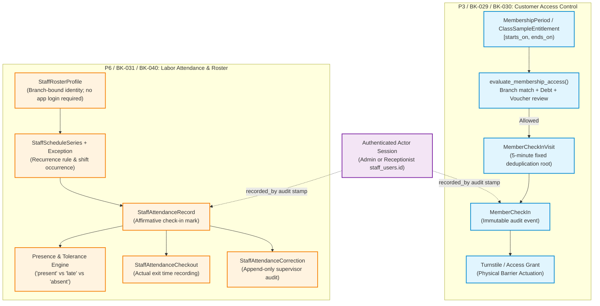
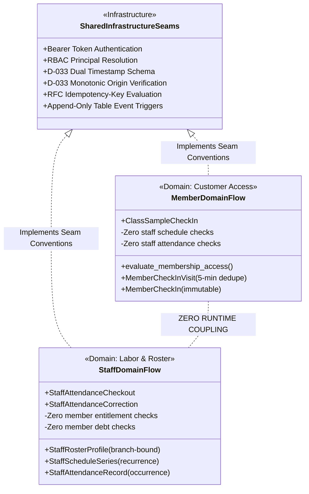

# P6.7 / C-16 — Member-Staff Integration Boundary & Dependency Reconciliation Contract

**Document Status:** Ready for Review  
**Author:** Luna (Senior Systems & Documentation Architect)  
**Base Commit:** `82fc09b7b88be783ec978da2407a32bad48045c3` (source baseline: `3996c62acfeac8c7f367032a61bf95f331ccf1b8`)  
**Scope:** Architecture Analysis, Domain Decoupling, and Master Ledger Reconciliation  
**Primary Owners:** P3 (Member BK-029 / BK-030) and P6 (Staff BK-031 / BK-040)  
**Applicable Policies:** D-006 (Transfer funds verification), D-013 / R-007 (Debt admission gates), D-019 (Paid class sample lifecycle), D-031 (Membership entitlement evaluation), D-032 (Staff schedules and attendance), D-033 (Offline clock integrity and replay), R-012 (Server authority), R-013 / R-022 (Idempotency and replay), R-014 (Labor/attendance separation from customer access), R-023 (Untrusted client claims)

---

## 1. Executive Summary & Context of the Historical Dependency

### 1.1 Executive Summary
During the initial architectural scoping of EvoGym, the master task ledger (`odd/tasks/backend-implementation.md`) recorded a reciprocal dependency between **BK-029** (Member Check-in against Entitlements/Debt) and **BK-031** (Attendance / Trial API Flows Integration):
- **BK-029 listed dependencies:** `BK-026, BK-027, BK-031, BK-064`
- **BK-031 listed dependencies:** `BK-029, BK-030, BK-064`

This mutual circular dependency created an artificial development blocker across Work Packages **P3** (Member Experience & Access Control) and **P6** (Staff Schedules & Labor Attendance).

This contract (**C-16**) performs an exhaustive architectural and codebase analysis of both flows. It establishes that:
1. **Zero Runtime Coupling:** Member check-in and staff attendance are strictly orthogonal operational domains. Member facility access is evaluated purely against contract entitlements, validity periods, branch assignment, and financial settlement. Staff attendance (or absence) has **zero operational or authorization impact** on member check-in.
2. **Zero Identity Merging:** Member entities (`Member`) and Staff Roster profiles (`StaffRosterProfile`) reside in segregated database schemas and lifecycle models. Per policy **D-032**, staff roster profiles are branch-bound and are never globally merged or cross-checked against member identities.
3. **Shared Infrastructure Seams:** The two domains do not interact through domain entities; rather, they share common platform infrastructural conventions:
   - Session & RBAC principal resolution (`MemberActorPrincipal` / `validate_session`).
   - Clock integrity and dual-timestamp synchronization mandated by **D-033**.
   - Strict idempotency key handling and payload fingerprint verification (**R-013**, **R-022**).
4. **Master Ledger Decoupling:** BK-029 and BK-031 must be unlinked in the canonical ledger, eliminating the reciprocal dependency and allowing each work package to complete independently.

### 1.2 Historical Context of the Dependency
The historical inclusion of `BK-031` in `BK-029` (and vice-versa) originated from three early conceptual conflations:
- **Physical Reception Desk Conflation:** Early product planning viewed "the reception desk" as a unified actor. It was intuitively assumed that because a receptionist physically operates the reception terminal where members present QR codes, the system needed an active, clocked-in staff shift to validate member entry.
- **Lexical Umbrella ("Check-In / Attendance"):** The terms "member check-in" and "staff attendance check-in" were grouped under a single business umbrella ("attendance flows"), leading to the presumption of a shared data structure or unified processing pipeline.
- **Contingency / Offline Sync Bundling (BK-064):** Both domains require offline resilience under Contingency Mode (**BK-061**–**BK-076**). Early backlog mapping conflated the shared requirement for local-first event queueing into a cross-domain feature dependency.

Subsequent implementation of online member check-in (`api/app/api/member_check_ins.py`, commit `05497d9`) and staff schedule/attendance structures (`api/app/api/staff_schedules.py`, `api/app/api/staff_attendance.py`) definitively proved that neither domain references or requires runtime data from the other.

---

## 2. Domain Boundary Comparison



### 2.1 Detailed Architectural Matrix

| Dimension | Member Access Flow (P3 / BK-029) | Staff Labor Flow (P6 / BK-031 / BK-040) |
|---|---|---|
| **Core Entity** | `Member` (`members.id`) | `StaffRosterProfile` (`staff_roster_profiles.id`) |
| **Identity Scope** | Organization-wide member profile; access checked against specific `branch_id`. | Strictly branch-bound profile (`branch_id`, `id`). Prohibited from cross-branch merging by **D-032**. |
| **Account Requirement** | Member does not require an administrative system account; identified by QR code, membership number, or NFC token. | Profile does **not** require a `staff_users` login account (**D-032**). Represents coaches, maintenance, and floor staff. |
| **Entitlement Source** | Purchased `MembershipPeriod` interval $[starts\_on, ends\_on)$ or single-use `ClassSampleEntitlement`. | Assigned recurring `StaffScheduleSeries` and `StaffScheduleException` occurrences. |
| **Evaluation Rules** | Policy **D-031** via `evaluate_membership_access()`: branch equality, date validity, voucher status (`under_review`, `confirmed`), debt payment rules. | Policy **D-032**: scheduled start time, dynamic grace tolerance window ($N$ minutes), single-occurrence overrides. |
| **Temporal Model** | Wall-clock check-in event anchored to server UTC; evaluation on branch-local date. | Scheduled occurrences across weekly recurrence cycles ($146,096$-day Gregorian cycle); shift start/end times. |
| **Deduplication / Cooldown** | 5-minute ($300\text{s}$) fixed-window visit deduplication (`MemberCheckInVisit`). Duplicate attempts point to existing visit without extending window. | Occurrence uniqueness constraint: at most one affirmative attendance record per `(branch_id, profile_id, series_id, occurrence_date)`. |
| **Exit Tracking** | Exit not tracked for regular members. For class samples (**D-019**), physical exit terminates the entitlement. | Explicit, immutable exit recording via `StaffAttendanceCheckout`. Missing exits are **never** inferred (**D-032**). |
| **Corrections** | Strictly append-only. Access decisions and check-in audit events are immutable; denied attempts do not consume entitlements. | Append-only audit trail via `StaffAttendanceCorrection` capturing original value, corrected value, actor, and justification. |
| **Physical Actuation** | Triggers physical door turnstile / speed gate release or reception validation sound. | Digital punch/roster status display on staff dashboard; payroll/labor accounting input (**BK-041**). |

### 2.2 Deep Dive: Member Check-In Execution (P3)
The production member check-in pipeline (`api/app/api/member_check_ins.py`) demonstrates complete autonomy from staff attendance data:
1. **Actor Authorization:** An incoming request arrives with a Bearer token. `get_member_actor_principal` verifies that the actor has `Permission.MEMBER_OPERATIONAL_READ` for `branch_id`. The actor is recorded in `recorded_by: UUID` for auditability only.
2. **Entitlement Resolution:** The `MembershipPeriod` is fetched. Local date is computed using `branch.timezone`.
3. **Authoritative Evaluation:** `evaluate_membership_access(session, period.id, on_date, branch_id)` executes in `api/app/memberships/eligibility.py`:
   - Checks `order.branch_id == branch_id`.
   - Checks `period.starts_on <= on_date < period.ends_on`.
   - Checks payment method and voucher verification state (**D-006**).
   - Checks outstanding debt balances (**D-013**).
4. **Visit Deduplication:** The member row is locked (`SELECT FOR UPDATE`). If a `MemberCheckInVisit` exists with `occurred_at - visit.started_at < 300` seconds, the existing visit is reused; otherwise, a new `MemberCheckInVisit` root is inserted.
5. **Event Emission:** An immutable `MemberCheckIn` record is appended.

*Notice:* At no point in the execution graph does the code inspect whether *any* staff member is clocked in, whether the receptionist is late, or whether a staff schedule exists for the current hour.

### 2.3 Deep Dive: Staff Schedules & Attendance Execution (P6)
The staff attendance architecture (`api/app/api/staff_schedules.py`, `staff_attendance.py`, and contracts **P6.1**, **P6.2**) operates under independent domain mechanics:
1. **Roster Independence:** `StaffRosterProfile` represents a human worker bound to a specific gym facility. There is no link to `members.id`.
2. **Recurrence Computation:** Shifts are derived from `StaffScheduleSeries` (specifying day of week, start/end time) and modified by `StaffScheduleException` (date-specific `skip` or `override`).
3. **Occurrence Linkage:** Check-ins are bound to a concrete shift occurrence `(series_id, occurrence_date)`.
4. **Classification:** Punctuality status (`present` vs `late`) is computed against `scheduled_start_time + grace_tolerance_minutes`. Unmarked past occurrences represent `absent` states without synthetic row insertion.
5. **Labor Separation:** Per policy **R-014**, staff attendance tracks operational labor and payroll liabilities. It is completely isolated from customer membership accounting.

---

## 3. Shared Infrastructure Seams vs Orthogonal Domain Invariants

While the domain models are orthogonal, both domains leverage shared architectural seams provided by the EvoGym platform foundation.



### 3.1 Shared Authentication & Authorization Seam
Both domains utilize standard FastAPI security dependencies:
- **Principal Extraction:** `validate_session` and `validate_admin_session` parse Bearer JWTs, resolving the actor's `staff_id`, `branch_id`, and granted permission set.
- **Scope Verification:**
  - Receptionists have branch-bound authority (`principal.branch_id == branch_id`).
  - System Administrators possess global authority (`principal.is_admin == True`, `branch_id = None`).
- **Audit Attribution:** In both domains, the authenticated user is stamped into the `recorded_by` foreign key column (referencing `staff_users.id`). The `recorded_by` field denotes *who operated the software*, not a domain relationship between the subjects.

### 3.2 Shared D-033 Clock Integrity & Verification Seam
Both member check-ins and staff attendance events must withstand client clock drift, tampering, and offline synchronization under **D-033**:
1. **Dual-Timestamp Schema:**
   - `device_captured_at`: The raw, unadjusted wall-clock timestamp captured by the client terminal/scanner.
   - `server_received_at` / `occurred_at`: The authoritative UTC timestamp assigned by the backend upon ingestion.
2. **Monotonic Elapsed Origin:**
   - When synchronizing offline events, clients submit monotonic clock readings (`t_mono_event`, `t_mono_anchor`).
   - The server verifies that elapsed monotonic time matches the trusted server anchor within a **5-minute skew tolerance** ($|\Delta t| \le 300\text{s}$).
3. **Anomaly Handling:**
   - If skew exceeds $300\text{s}$, or if monotonic origin cannot be verified, the event is **not rejected or altered**. It is ingested with `clock_validation_status = 'skew_detected'` or `'unverified'` and flagged with `review_required = True`.
4. **Strict Non-Fabrication:** The backend **never** fabricates, overwrites, or silences raw device capture timestamps.

### 3.3 Shared Idempotency & Replay Seam
Both endpoints implement robust network retry protection following **R-013** and **R-022**:
- **Header:** `Idempotency-Key` (UUIDv4 or client string, 1–128 characters).
- **Request Fingerprinting:** A cryptographic hash (SHA-256) is computed over the immutable request payload:
  $$\text{Fingerprint}_{\text{member}} = \text{SHA256}(\text{branch\_id} \mathbin{\Vert} \text{period\_id} \mathbin{\Vert} \text{principal.staff\_id})$$
  $$\text{Fingerprint}_{\text{staff}} = \text{SHA256}(\text{branch\_id} \mathbin{\Vert} \text{profile\_id} \mathbin{\Vert} \text{series\_id} \mathbin{\Vert} \text{occurrence\_date} \mathbin{\Vert} \text{principal.staff\_id})$$
- **Replay Invariant:**
  - Exact retry (same key + same fingerprint) $\rightarrow$ Returns original `200 OK` snapshot with `replayed: true`. No secondary database rows or visit roots are created.
  - Conflicting retry (same key + different fingerprint) $\rightarrow$ Raises `409 Conflict` (`CheckInConflictResponse`).

### 3.4 Invariant: Zero Runtime Coupling
> [!IMPORTANT]
> **Core Architectural Invariant (R-014):**
> Staff attendance is **NEVER** a prerequisite for member check-in, turnstile actuation, or facility entry.
> 
> Valid member entitlements grant immediate access regardless of whether:
> 1. Staff members scheduled for the shift are late, absent, or unrecorded.
> 2. The reception desk is unstaffed or operating in automated turnstile mode.
> 3. Staff attendance records for the date contain clock skew anomalies or pending reviews.
> 
> Under no circumstances may a software deployment lock gym access doors or deny valid member check-ins due to staff attendance state.

### 3.5 Invariant: Zero Identity Merging (D-032 Compliance)
- A gym member who also works as an employee (e.g., a fitness trainer who exercises at the gym) possesses **two completely independent entity records**:
  1. A `Member` record in `members` (holding membership contracts, payment debt, emergency contacts, and check-in visits).
  2. One or more `StaffRosterProfile` records in `staff_roster_profiles` (holding branch-bound shift schedules, hourly labor classifications, and attendance punches).
- Per **D-032**, `StaffRosterProfile` records in different branches are also completely independent:
  - No global staff identity links them across branches.
  - Overlap checks run **only** within the same profile in the same branch.
  - No database foreign keys or unique constraints bridge `members` and `staff_roster_profiles`.

---

## 4. Formal Recommendation to Master Ledger Owner

To eliminate the artificial cyclic blocker in the project management tracking files, the master ledger owner for `odd/tasks/backend-implementation.md` must execute the following reconciliation.

### 4.1 Dependency Ledger Modifications

#### In `odd/tasks/backend-implementation.md`:
1. **Task BK-029 (Member Check-In):**
   - **Current Dependencies:** `BK-026,BK-027,BK-031,BK-064`
   - **Proposed Dependencies:** `BK-026,BK-027,BK-064`
   - **Action:** Remove `BK-031`.

2. **Task BK-031 (Staff Schedule & Attendance API Flows):**
   - **Current Dependencies:** `BK-029,BK-030,BK-064`
   - **Proposed Dependencies:** `BK-064`
   - **Action:** Remove `BK-029` and `BK-030`. (Note: BK-031 is part of Work Package P6, which depends on P1 session foundations and P7 offline infrastructure, not customer access control).

### 4.2 Exact Reconciliation Text for Ledger Notes

The following text is recommended for insertion into the progress notes of `odd/tasks/backend-implementation.md` under **BK-029** and **BK-031**:

```markdown
### Architectural Boundary Reconciliation (Contract P6.7 / C-16)
Per architectural contract P6.7 / C-16 (`docs/work-packages/contracts/member-staff-integration-boundary.md`), 
the reciprocal dependency between BK-029 (Member Check-In) and BK-031 (Staff Attendance/Trial Integration) 
has been formally analyzed and dissolved:
1. Member access control (BK-029) is governed solely by customer entitlement evaluation (evaluate_membership_access), 
   branch matching, payment settlement, and 5-minute visit deduplication. It has zero runtime dependence on staff 
   schedules, staff attendance marks, or staff presence.
2. Staff schedules and labor attendance (BK-031 / BK-040) are governed by branch-bound roster profiles (D-032), 
   recurring shift occurrences, and append-only attendance records. They have zero dependence on member check-ins.
3. Both flows share platform infrastructure seams (Bearer session auth, D-033 clock integrity, idempotency keys), 
   but maintain zero domain coupling and zero identity merging.
BK-029 dependency on BK-031 is removed; BK-031 dependency on BK-029/BK-030 is removed. Both subpackages 
may proceed independently to completion.
```

---

## 5. Invariants, Failure Scenarios, and Verification Matrix

### 5.1 System Invariants
- **INV-BOUNDARY-01 (Access Autonomy):** `record_member_check_in()` shall never execute queries against `staff_attendance_records`, `staff_roster_profiles`, `staff_schedule_series`, or `staff_schedule_exceptions`.
- **INV-BOUNDARY-02 (Labor Autonomy):** `record_staff_attendance()` shall never execute queries against `members`, `membership_periods`, `member_check_in_visits`, `member_check_ins`, or `membership_debts`.
- **INV-BOUNDARY-03 (Audit Decoupling):** The presence of `recorded_by` on both `MemberCheckIn` and `StaffAttendanceRecord` serves strictly for administrative actor audit and does not establish a relational join between member and staff domain lifecycles.
- **INV-BOUNDARY-04 (Turnstile Independence):** Physical access barriers (turnstiles, magnetic locks) actuated by member check-in validation shall unlock upon valid entitlement confirmation regardless of whether reception staff are clocked in.
- **INV-BOUNDARY-05 (Branch Isolation):** Neither member nor staff records may be evaluated across branch boundaries unless explicitly authorized by global Admin role credentials.

### 5.2 Failure & Edge Case Scenarios

| Failure Scenario | Member Access Flow Impact | Staff Attendance Flow Impact | Architectural Handling & Recovery |
|---|---|---|---|
| **No Receptionist on Duty**<br/>(Staff scheduled shift missed, unclocked, or late) | **Zero Impact.** Members scanning QR codes at automated turnstiles or mobile readers are admitted if membership period is valid. | Marked as `absent` or `late` in staff attendance reports. Alert raised on Manager dashboard. | Member check-in relies solely on server UTC and entitlement evaluator; staff absence does not halt customer operations. |
| **Staff Member Trains as Customer**<br/>(Employee works out before/after shift) | Member flow executes normally using the employee's `member_id` and personal `MembershipPeriod`. | Staff flow executes independently when the employee punches in using their `profile_id`. | Profiles remain distinct entities in separate tables. No cross-table deduplication or constraint evaluation occurs. |
| **Client Terminal Clock Drift (>5m)**<br/>(Offline tablet clock desynchronized) | Event accepted or queued; flagged with `review_required = True`. 5-minute visit dedupe uses capture time for window grouping. | Event accepted; flagged with `clock_validation_status = 'skew_detected'` and `review_required = True`. | Both domains apply **D-033**: retain raw device timestamp, record server received timestamp, flag for review without timestamp fabrication. |
| **Network Partition / Offline Burst**<br/>(Branch internet disconnected during peak morning check-ins) | Offline queue records local check-ins with monotonic origin. Reconnect flushes batch with idempotency receipts (**BK-066**). | Staff mark captured on local IndexedDB queue with cached shift occurrence ID. Reconnect flushes to backend. | Queues are segregated in local storage. Batch ingestion revalidates each stream against its respective domain authority. |
| **Rapid Double Badge Scan (<5s)**<br/>(Member or staff taps twice in rapid succession) | First scan creates `MemberCheckInVisit` and `MemberCheckIn`. Second scan with new key links to existing visit root as duplicate event. Same key returns `replayed: true`. | First mark records attendance. Second mark with same occurrence ID fails with `409 Conflict` (`uq_staff_attendance_series_occurrence`). Same key returns `replayed: true`. | Member flow groups into single physical visit; staff flow rejects redundant shift punch. |

### 5.3 Acceptance & Architectural Review Checklist

- [x] **Executive Context:** Historical rationale for reciprocal BK-029/BK-031 dependency thoroughly documented and traced to early backlog conflation.
- [x] **Domain Independence:** Explicit proof that `MemberCheckIn` and `StaffAttendanceRecord` have zero cross-table queries, foreign keys, or runtime prerequisites.
- [x] **Policy D-032 Compliance:** Confirmed branch roster profile isolation; no global identity unification or cross-branch deduplication.
- [x] **Policy D-033 Compliance:** Dual-timestamping schema, server UTC anchor, monotonic origin verification, and non-fabrication rules confirmed across both domains.
- [x] **Policy R-014 Compliance:** Separation of staff labor accounting from customer facility access explicitly guaranteed.
- [x] **Idempotency Architecture:** Replay and conflict behaviors specified with SHA-256 fingerprinting.
- [x] **Master Ledger Guidance:** Exact modification text and rationales prepared for `odd/tasks/backend-implementation.md`.
- [x] **Verification Matrix:** Concrete invariants and fault handling scenarios tabulated.

---

## 6. Document Sign-off & Next Steps

This contract resolves the requirements of subtask **P6.7** and establishes **Contract C-16**.

Upon sign-off by the P3 and P6 package owners:
1. The master ledger owner will update `odd/tasks/backend-implementation.md` to remove the cross-block between BK-029 and BK-031.
2. P3 will proceed with offline queue and entitlement revalidation integration (**BK-064** / **P7**).
3. P6 will proceed with occurrence-linked attendance runtime execution (**P6.3** / **STAFF-2**) and FE09 live screen binding (**P6.4**).
